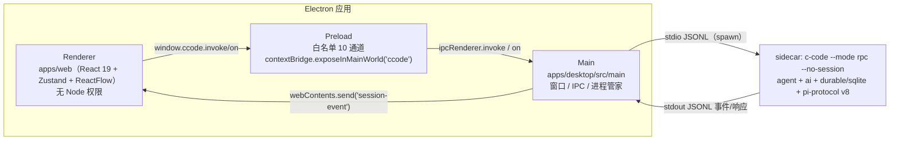
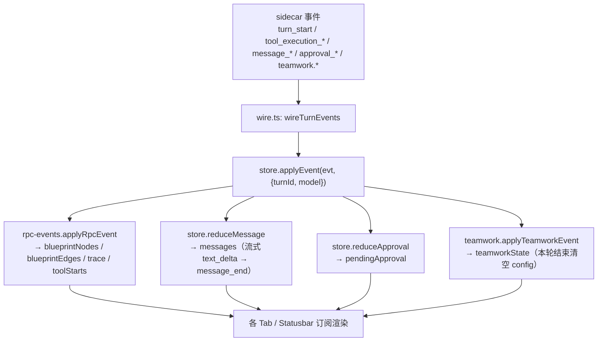

# 01 · 整体架构

## 1. 定位与目标

C-code Desktop 的 V1 目标是「双击即用」的 Coding 专精桌面端：多 session 并行、turn 流式对话、diff/审批、模型透明台、分工（teamwork）、蓝图（blueprint）、轨迹（trace）、本地 BYOK。

基座是 `/Users/cyc/Desktop/C-code`（Pi fork，`@earendil-works/*`），本仓库**不包含、也不修改基座源码**，只消费其构建产物（包形态 sidecar）与 v8 RPC 协议。

非目标（V1）：远端多机、云 thread、插件市场、全量自动更新。

## 2. 进程模型

三层职责边界：

| 层 | 位置 | 职责 | 明确不做 |
| --- | --- | --- | --- |
| Main | `apps/desktop/src/main/` | 找 sidecar 二进制、设置 env、spawn 并保活、JSONL 帧切分与请求/响应配对、转发事件、本地文件读写（models.json/pid/log） | 不解析业务语义、不缓存会话状态 |
| Preload | `apps/desktop/src/preload/index.ts` | 仅暴露 `invoke(channel, payload)` 与 `on(channel, cb)`，通道白名单 | 不做 RPC 封装、不做参数校验 |
| Renderer | `apps/web/src/` | 全部 UI、状态（zustand）、事件归约（消息/蓝图/轨迹/分工/审批）、localStorage 持久化、Web 降级 | 不直接接触 Node/子进程；不伪造 sidecar 数据 |

## 3. 通信链路

### 3.1 出站（Renderer → sidecar）

1. 组件调用 `invokeRpc(cmd)`（`apps/web/src/lib/bridge.ts`）。
2. Preload `ccode.invoke("rpc", cmd)` → Main `ipcMain.handle("rpc")`。
3. Main 补 `id`（缺省 `req-<ts>-<seq>`），`JSON.stringify(cmd) + "\n"` 写入 sidecar stdin，登记 `pending` 表（30s 超时）。
4. sidecar 以 `{type:"response", id, success, ...}` 返回，Main 的 `routeRecord()` 命中 `pending` 后 resolve 对应 Promise。

### 3.2 入站（sidecar → Renderer，单向推送）

1. sidecar stdout 按 `\n` 切帧（`splitFrames`，严格 LF，U+2028/29 不切分），残片留在 `stdoutRest`。
2. 非响应记录 → `win.webContents.send("session-event", rec)`。
3. Renderer `wireTurnEvents()`（`lib/wire.ts`）订阅 `session-event` 与 `turns` 两个通道，事件交给 `store.applyEvent()` 归约。

### 3.3 sidecar 生命周期（Main 六件事）

实现在 `apps/desktop/src/main/index.ts`：

| 事项 | 位置 | 说明 |
| --- | --- | --- |
| 找二进制 | `resolveBin()` L23-37 | 候选顺序 `resources/bin/c-code`（相对 `app.getAppPath()`）→ `vendor/c-code` → `PATH` 上的 `c-code` |
| 设 env | `startSidecar()` L52-59 | `C_CODE_HOME`（缺省 `~/.c-code`）+ `NO_COLOR=1` |
| spawn 长驻 | L56-59 | `buildRpcArgs(workspace)` = `--mode rpc --no-session [--cwd <workspace>]`；stdio 三管全开 |
| 写 pid | `pidfile.writePid` | `~/.c-code/app-server-desktop.pid` |
| 杀整树 | `stopSidecar()` L94-109 | 先 `stdin.end()` 优雅退出，2s 后强杀（`app.on("before-quit")` 触发） |
| 日志/退出 | `stderr → appendLog`、`exit → 广播 sidecar_exit` | 日志 `~/.c-code/logs/desktop/app.log`，1MB 轮转 3 份 |

> 协议握手工具（`PROTOCOL_VERSION = 8`、`HANDSHAKE_TIMEOUT_MS = 5000`、`isHandshakeOk()`）已在 `sidecar.ts` 定义，但当前 `startSidecar` 未执行 hello 握手，直接进入帧转发；详见 [09-known-gaps.md](./09-known-gaps.md)。

## 4. 状态管理与数据流

渲染层只有**一个 zustand store**（`apps/web/src/lib/store.ts`），所有事件经一个归约入口：

持久化分工：

| 数据 | 位置 | 触发 |
| --- | --- | --- |
| 会话索引（id/title/updatedAt） | localStorage `ccode.sessions.v1` | `sessions` 变化时 `saveSessions` |
| 会话正文（messages/trace） | localStorage `ccode.session.<id>.v1` | 消息/轨迹/会话切换时 `saveSessionData` |
| 提供商配置 | `~/.c-code/agent/models.json`（桌面端）或 localStorage（Web） | 设置面板保存 |
| 工作区列表 / 设置 / 个人资料 / 选中模型 / 思考档 | localStorage（`ccode.workspaces.v1` 等） | 对应面板操作 |
| 蓝图 / 轨迹的跨会话恢复 | **不持久化到磁盘**，仅会话 content 里的 trace；蓝图随会话切换清空 | — |

> 注意：消息只落 localStorage，sidecar 侧（`~/.c-code` 的 sqlite 等）由基座自行管理，两边**当前没有做历史回灌**（`get_entries` 返回值未使用）。

## 5. 安全模型

| 措施 | 实现 |
| --- | --- |
| 渲染进程无 Node | `contextIsolation: true` + `sandbox: true` + `nodeIntegration: false`（`index.ts` L111-126） |
| 通道白名单 | preload 仅放行 10 个通道：`sessions / turns / approval / models / blueprint / settings / log / rpc / session-event / models-json` |
| 密钥只存本机 | `models.json` 写入时 `mode 0o600` 并 `chmod 600`；不进轨迹、不随导出 |
| 探测不造假 | 「测试连接」真实请求 `GET {base}/models`，失败原样返回 HTTP 状态 |
| 审批卡 | 仅当 sidecar 真发 `approval_request / tool_approval_request` 才出现；操作走 `extension_ui_response` |
| 本地服务标识 | Ollama/自定义端点允许空 Key，但 UI 如实标注「未填 API Key」 |
| Web 降级透明 | 无 bridge 时报 `WEB_NO_SIDECAR` 哨兵，提示「未写入 sidecar」，不伪造连通/轨迹 |

sidecar 本身**没有 sandbox**（沿用基座能力），写外动作依赖审批卡放行 —— 这是产品明示的风险。

## 6. 设计原则（供扩展时遵守）

1. **扁平优先**：不设 `packages/*`；共用小函数放 `apps/web/src/lib/`，复制比抽象便宜。
2. **直调协议**：`apps/desktop` 与 `apps/web` 直接使用 v8 命令/事件名，中间不加 RPC/UI 抽象层。
3. **注册式扩展**：
   - 新增 Tab：`tabs-xxx/` + `config/tabs.json` 加一行；
   - Main 进程每个文件独立（sidecar/pidfile/log/rpc-bridge），删文件不影响其他；
   - 新增模型：改 `lib/providers.ts` 的 `PROVIDER_PRESETS` 数组即可。
4. **不伪造数据**：所有「模型台/轨迹/蓝图/分工/审批」必须有真实事件来源，无数据时显示空态与原因。

## 7. 相关文档

- 主进程细节 → [02-main-process.md](./02-main-process.md)
- 状态/事件归约细节 → [03-renderer-shell.md](./03-renderer-shell.md)、[05-core-libraries.md](./05-core-libraries.md)
- 命令与事件清单 → [06-protocol-and-data.md](./06-protocol-and-data.md)
- 与基座/三方依赖的关系 → [07-dependencies.md](./07-dependencies.md)