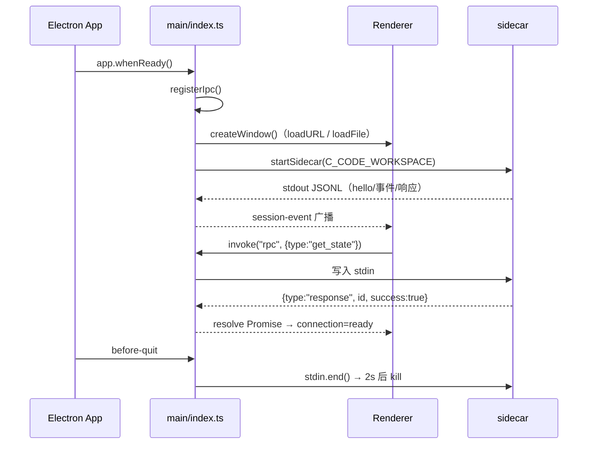

# 02 · 主进程与 Preload（apps/desktop）

## 1. 模块总览

```
apps/desktop/
├── package.json               # @c-code/desktop（main: dist/main/index.js，构建脚本）
└── src/
    ├── main/
    │   ├── index.ts           # 入口：窗口 + IPC + sidecar 编排（241 行）
    │   ├── sidecar.ts         # 二进制选择 / env / 握手工具（纯函数，20 行）
    │   ├── rpc-bridge.ts      # JSONL 帧切分 + spawn 参数 + models.json 读写（66 行）
    │   ├── pidfile.ts         # pid 文件路径与写入（9 行）
    │   └── log.ts             # 日志追加 + 1MB 轮转（30 行）
    └── preload/index.ts       # 白名单 contextBridge（14 行）
```

每个文件独立、无相互循环依赖；`index.ts` 是唯一有副作用的编排点。

## 2. `src/main/index.ts` 详解

### 2.1 模块级状态（L13-17）

| 变量 | 类型 | 用途 |
| --- | --- | --- |
| `win` | `BrowserWindow \| null` | 主窗口引用，事件转发目标 |
| `sidecar` | `ChildProcess \| null` | 常驻 sidecar 句柄；非空即「已启动」 |
| `stdoutRest` | `string` | JSONL 切帧残片缓冲 |
| `pending` | `Map<string, {resolve, reject, timer}>` | 请求 id → Promise 回调 + 30s 超时定时器 |
| `reqSeq` | `number` | 请求 id 自增序号 |

### 2.2 关键函数

| 函数 | 位置 | 说明 |
| --- | --- | --- |
| `logDir()` | L19-21 | `~/.c-code/logs/desktop`（跟随 `C_CODE_HOME`） |
| `resolveBin()` | L23-37 | 用 `app.getAppPath()` 拼 `resources/bin/c-code`（dev 与打包后均含该目录），交给 `pickBin` 按存在性选择；注释明确「不要按 out/main 深度数 `..`」 |
| `routeRecord(rec)` | L39-50 | 命中 `type === "response"` 且 id 在 `pending` → 清定时器、resolve/reject；否则 `webContents.send("session-event", rec)` 广播给渲染层 |
| `startSidecar(workspace?)` | L52-92 | 幂等（已有进程直接返回）；spawn `rpcArgs` + env；写 pid；按 LF 切帧解析 stdout；stderr 写日志；`exit` 时 reject 全部 pending 并广播 `{type:"sidecar_exit", code}` |
| `stopSidecar()` | L94-109 | `stdin.end()` 优雅退出 → 2s 后 `kill()` 兜底（`unref` 不阻塞进程退出） |
| `createWindow()` | L111-126 | 1280×860、`hiddenInset` 标题栏；dev 有 `ELECTRON_RENDERER_URL` 时 `loadURL`，否则 `loadFile("../web/dist/index.html")` |
| `registerIpc()` | L128-231 | 注册 `rpc`、`models-json` 两个主处理器 + 7 个兼容通道（详见 §3） |

### 2.3 启动与退出时序



## 3. IPC 通道

### 3.1 `ipcMain.handle("rpc", cmd)`（L129-147）

通用直通：补 id → 写 stdin → 等响应。`sidecar` 未就绪抛 `sidecar 未就绪`；30 秒无响应抛 `rpc 超时`；写流异常立即 reject 并清理 pending。

### 3.2 `ipcMain.handle("models-json", payload)`（L148-209）

| `payload.op` | 行为 | 落点 |
| --- | --- | --- |
| `load` | 读 `~/.c-code/agent/models.json`，缺省 `{providers:{}}` | `rpc-bridge.loadModelsJson` |
| `save` | 读旧文件 → `mergeProviders`（按 providerId 覆盖一项）→ 写回（0600） | `rpc-bridge.saveModelsJson` |
| `remove` | 读旧文件 → 删指定 providerId → 写回 | 同上 |
| `probe` | **真实发起** `fetch(url, {headers})`，解析 `data/models` 列表；非 JSON 不列模型；非 2xx 返回 `{ok:false, message:"HTTP …"}` | 用于「测试连接」 |
| `transcribe` | 主进程代发语音转写：`FormData(file + model)` POST，返回 `{ok,text,message}` | 避开渲染进程 CORS |

> 这是渲染层唯一「不经 sidecar」的本地能力通道，实现全部在 Main（fetch 只有主进程有网络豁免）。

### 3.3 兼容通道（L211-230）

`sessions / turns / approval / models / blueprint / settings / log` 七个旧通道仍注册：把 `payload` 原样写入 stdin 并附加 `__channel` 字段，语义与 `rpc` 相同（旧 renderer 逐步迁移用）。当前渲染层主要走 `rpc`。

## 4. `src/main/sidecar.ts`

| 导出 | 值/签名 | 说明 |
| --- | --- | --- |
| `SIDECAR_BIN_CANDIDATES` | `["resources/bin/c-code", "vendor/c-code", "c-code"]` | 按序探测；最后一项是 PATH 兜底 |
| `PROTOCOL_VERSION` | `8` | 与基座 pi-protocol v8 对齐 |
| `HANDSHAKE_TIMEOUT_MS` | `5000` | 握手超时设计值 |
| `pickBin(cands, exists)` | `(string[], (p)=>boolean) => string` | 首个存在的候选；都不存在取最后一项（交给 spawn 报错） |
| `buildEnv(home)` | `(string) => {C_CODE_HOME, NO_COLOR}` | 注入 sidecar 环境 |
| `isHandshakeOk(line, serverId)` | `(string, string) => boolean` | 解析 hello 行并校验 `type/serverId/version`；**当前主流程未调用** |

## 5. `src/main/rpc-bridge.ts`

| 导出 | 说明 |
| --- | --- |
| `buildRpcArgs(cwd?)` | `["--mode","rpc","--no-session"]`，有 workspace 时追加 `["--cwd", cwd]` |
| `splitFrames(buf)` | 按 `\n` 切分，返回 `{frames, rest}`；空帧过滤，残片保留（逐字节累积，防背压） |
| `encodeCommand(cmd)` | `JSON.stringify(cmd) + "\n"` |
| `parseRecord(line)` | 宽容解析：空白行/坏 JSON 返回 `undefined`，不抛错 |
| `codeHome()` | `C_CODE_HOME` 或 `~/.c-code` |
| `modelsJsonPath(home?)` | `<home>/agent/models.json` |
| `loadModelsJson(file)` | 读 + 归一化为 `{providers}`；文件缺失/坏 JSON → `{providers:{}}` |
| `mergeProviders(prev, providerId, entry)` | 返回新对象（不改原引用），按 providerId 覆盖 |
| `saveModelsJson(file, data)` | `mkdir -p` + 写入（2 空格缩进）+ `mode 0600` 兜底 `chmod` |

## 6. `src/main/pidfile.ts` 与 `src/main/log.ts`

- `pidPath(home, profile)` → `<home>/app-server-<profile>.pid`；`writePid` 写裸 pid 文本。桌面端 profile 固定 `"desktop"`。
- `log.ts`：`MAX_BYTES = 1_048_576`；`shouldRotate(size)`；`rotatedNames(base)` → `[app.log, app.log.1, app.log.2]`；`appendLog(dir,msg)` 先轮转再追加，缺失文件视为无需轮转。

## 7. `src/preload/index.ts`

```ts
const channels = ["sessions","turns","approval","models","blueprint","settings","log","rpc","session-event","models-json"];
contextBridge.exposeInMainWorld("ccode", {
  invoke: (channel, payload) => ipcRenderer.invoke(channel, payload),
  on: (channel, cb) => { /* ipcRenderer.on 包装，返回退订函数 */ },
});
```

- 渲染层可见的全局对象只有 `window.ccode`；无 Node API 泄漏。
- `invoke` 不做参数校验/序列化封装；`on` 返回 `removeListener` 闭包（桥接层做资源清理）。
- 新增通道需要同时改三处：本文件的 `channels`、`main/index.ts` 的 handler、`lib/bridge.ts` 或调用方。

## 8. `scripts/sync-sidecar.mjs`

把 `../C-code/packages/coding-agent` 的构建产物以**包形态**同步到 `resources/bin`：

1. 检查 `dist/bundle/cli.js` 是否存在，不存在则 `skip: no build at …`（不报错）。
2. 清空并重建 `resources/bin`；拷贝 `package.json` 与整个 `dist/`（包根标记，保证基座按包根解析 `dist/modes` 等资产）。
3. 生成入口 `c-code`（`#!/usr/bin/env node` + `import "./dist/bundle/cli.js"`），`chmod 755`。
4. 对 `../C-code/node_modules` 建 symlink（bundle 里的裸模块名靠它解析，dev 用）。
5. `resources/bin/` 在 `.gitignore` 中，不入库。

> 为什么要包形态：sidecar 的 `getPackageDir()` 从自身位置向上找 `package.json`，只拷 bundle 会找到 Electron 仓库根的 package.json，导致主题资产路径错位。

## 9. 扩展指引

- 加新窗口/托盘：直接在 `index.ts` 加函数，不抽类。
- 换 transport（ws/unix）：只改 `sidecar.ts` 的 spawn 参数与 `rpc-bridge.ts` 的帧切分。
- 加本地文件能力：新增一个 `ipcMain.handle("<name>")` + preload 白名单 + `lib/` 调用封装（参考 `models-json`）。