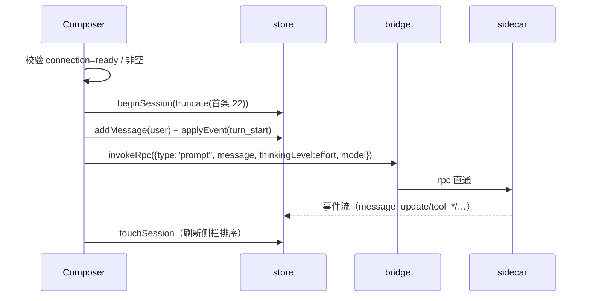

# 03 · 渲染进程外壳（Shell）

范围：入口、应用布局、全局 store、侧栏/顶栏/Composer/状态条/首页、通用组件与 hooks、主题体系。
功能 Tab（会话/轨迹/蓝图/分工/设置）见 [04-renderer-features.md](./04-renderer-features.md)。

## 1. 入口与挂载

| 文件 | 说明 |
| --- | --- |
| `apps/web/index.html` | `#root` 挂载点，`lang="zh-CN"`，脚本 `/src/main.ts` |
| `apps/web/src/main.ts` | `createRoot(#root).render(<App/>)`，导入 `theme.css`（9 行） |
| `apps/web/vite.config.ts` | 独立 `dev:web` 用：React 插件 + `base:"./"`（桌面端 file:// 加载必须相对路径，绝对 `/assets/*` 会 404 白屏）+ 固定端口 5199 |

## 2. `app.tsx`：布局与接线（162 行）

### 2.1 `useSidecarSync(enabled)`（L20-66）

一条 effect 完成「连 sidecar + 订阅事件 + 声明连接状态」：

1. `wireTurnEvents(cb)`：订阅 `session-event` / `turns`，事件交给 store：
   - `sidecar_exit` → `setConnection({status:"error", error:"sidecar exited <code>"})`；
   - 其余 → `applyEvent(evt, { turnId: evt.turnId ?? selectedTurn ?? "t-live", model: evt.model ?? selectedModel })`。
2. 若无 `window.ccode`（纯 Web）→ 直接 `connection: ready`（进入 Web 本地模式）。
3. 有 bridge → `invokeRpc({type:"get_state"})` 成功即 `ready`；随后 `get_entries` 仅调用、**返回值当前未回填**（`void entries`）。
4. 错误：`isWebNoSidecar` 视为本地模式（仍 ready），其他错误置 `error`。
5. 清理：`cancelled` 标记 + 退订函数。

### 2.2 `App` 组件（L68-162）

- 读 store：`activeTab / view / teamworkOn / sessions / sessionId / messages / trace`。
- 初始化 effect：
  - `setSessions(loadSessions())`；
  - 恢复 `ccode.selectedModel.v1`；`autoConfigureOllama()`（本地 Ollama 存活则自动写入配置，不覆盖已有配置，且仅当未选模型时选中第一个）；
  - `saveSessions(sessions)`（索引落盘）；
  - `saveSessionData(sessionId,{messages,trace})`（正文落盘）。
- 布局：
  - `<aside class="cc-sidebar">` 宽 280 / 折叠 64；
  - `<main>` 里 `cc-chrome`（Topbar + Tab 按钮组）→ `cc-stage`（Tab 面板 + 首页 hero 层 + Composer dock）→ `Statusbar`；
  - 首页 hero 只在 `view === "home" && activeTab === "session"` 时顶起（切到轨迹/蓝图必须让开）。
- Tab 从 `config/tabs.json` 渲染（`[{id:"session",title:"会话"},{id:"trace",title:"轨迹"},{id:"blueprint",title:"蓝图"}]`），切换面板 `session/trace/blueprint` 三分支。
- 全局浮层：`TeamworkPanel`（右侧滑出）、`SettingsPanel`（模态）。

### 2.3 布局树

```
cc-app
├── aside.cc-sidebar ── Sidebar（折叠/展开、设置入口）
└── main.cc-main
    ├── div.cc-chrome ── Topbar + nav.cc-tabs（会话/轨迹/蓝图）
    ├── div.cc-stage
    │   ├── div.cc-stage-scroll ── 当前 Tab 面板
    │   ├── div.cc-home-layer ── HomeHero（仅首页态）
    │   └── div.cc-dock ── Composer
    ├── Statusbar
    ├── TeamworkPanel（浮层）
    └── SettingsPanel（模态，条件渲染）
```

## 3. 全局 store（`lib/store.ts`，370 行）

单一 zustand store，无 middleware、无 selector 库。关键点：

### 3.1 状态字段（节选，完整见源码 L54-105）

| 分组 | 字段 |
| --- | --- |
| 会话 | `sessionId`（未落地的草稿固定 `"s0"`）、`sessionTitle`、`sessions`、`view`（home/chat） |
| 消息 | `messages: ChatMessage[]` |
| 执行 | `mode`（plan/build/yolo）、`effort`（7 档思考强度）、`selectedModel`（`provider/model`） |
| 蓝图 | `blueprintNodes`、`blueprintEdges`、`selectedNode` |
| 轨迹 | `trace: TraceEvent[]`（上限 500）、`toolStarts`（toolCallId → 开始时间） |
| 分工 | `teamworkOn`、`teamworkState`、`teamworkConfig`、`workers`（泳道） |
| 审批 | `pendingApproval` |
| 连接 | `connection: {status: connecting\|ready\|error, error?}` |

### 3.2 关键动作

| 动作 | 位置 | 语义 |
| --- | --- | --- |
| `newSession()` | L124-146 | 先落盘当前会话（非 s0），再整体清空为草稿态 `s0` |
| `beginSession(title)` | L147-154 | **首条消息才真正建会话**：分配 `s<ts>` id、起标题、登记侧栏、`view:"chat"`，返回 id |
| `openSession(id)` | L155-172 | 落盘当前 → 读目标 content（messages/trace）并切换 |
| `deleteSession(id)` | L177-205 | 索引 + 正文一起删（`removeSession` + `removeSessionEntry`）；若删的是当前会话，回退到新会话草稿态 |
| `deleteMessage(id)` | L208 | 按 id 从 messages 移除（用户/助手消息都支持） |
| `appendAssistantDelta(delta, model)` | L209-220 | 流式追加到末尾 streaming 助手消息，否则新建 |
| `applyEvent(evt, ctx)` | L252-282 | **唯一事件入口**：并轨调用 4 个归约器（见 §3.3），`teamwork.completed` / `phase=done|failed` 时清空 `teamworkConfig`（一次一配） |
| `resolveApproval(decision)` | L234-244 | 走 `ccode.invoke("rpc", {type:"extension_ui_response", id, confirmed})`；`once/always` → `confirmed:true`，`deny/rerun` → `false` |
| `applyRerun(fromId)` | L286-287 | 本地把 from 节点置 `running`、下游置 `stale`（`blueprint.rerunFromNode`） |
| `hydrate(nodes,edges,trace)` | L283 | 供外部整体注入蓝图/轨迹（当前仅测试用） |

### 3.3 归约函数（事件 → 状态）

| 函数 | 位置 | 职责 |
| --- | --- | --- |
| `applyRpcEvent`（外部） | `lib/rpc-events.ts` L61-179 | 蓝图节点 + 轨迹 + 计时 |
| `reduceMessage` | L318-368 | `message_update.assistantMessageEvent.text_delta` 流式追加；`message_end` 定稿并吸收 `usage`（input/output/cacheRead tokens、model） |
| `reduceApproval` | L293-315 | `approval_request / tool_approval_request` → 生成卡（file 取 `args.file/args.path`，缺省显示 toolName）；`approval_resolved / approval_cancelled` → 清空 |
| `applyTeamworkEvent`（外部） | `lib/teamwork.ts` L152-234 | 分工面板状态机 |

### 3.4 常量

- `MODE_LABELS / MODE_HINTS`：`plan=计划模式（只读分析）`、`build=构建模式（常规开发）`、`yolo=YOLO 模式（跳过确认）`。
- `EFFORT_LABELS`：`off/minimal/low/medium/high/xhigh/max`（与基座 `EXTENDED_THINKING_LEVELS` 对齐，兼容老三档）。
- 上限：`appendTrace` 保留最近 500 条。

## 4. 外壳模块

### 4.1 Sidebar（`sidebar/index.tsx`，411 行）

- 顶部：品牌 `C-code DESKTOP` + 折叠按钮。
- 操作区：「新会话」按钮；**TEAMWORK 启动器**（有进行中的 run 时切换面板开关；否则弹配置 sheet）。
- 工作区区：`loadSettings().workspace` 永远并入列表（防止删列表丢当前项目）；文件夹按钮切换工作区（写 settings + `newSession()`）；搜索（按标题过滤会话）；「添加项目」`AddProjectSheet`（校验绝对路径 → `upsertWorkspace` → 切为当前工作区）。
- 会话列表：`新会话` + 按 `updatedAt` 排序的会话行（相对天数标签 `dayTag`）；每行支持**二次确认删除**（点 × 后 3 秒内再点 ✓ 才调 `deleteSession`，超时自动取消）。
- 底部：用户卡（头像色 + 名字）→ Popover（设置 / 个人账号 `AccountSheet`）。
- 关联浮层：`TeamworkConfigSheet`、`AddProjectSheet`、`AccountSheet`。

### 4.2 Topbar（`topbar/index.tsx`，14 行）

只剩会话标题（注释明确「去 deepseek harness 化」：子智能体计数、模式、右角按钮已移除）。会话模式选择器改由 `topbar/mode-picker.tsx` 提供，仅在首页 hero 使用（`ModePicker compact`）。

### 4.3 Composer（`composer/index.tsx`，376 行）

结构：`textarea` + 附件 chips + 左组（QuickMenu `+`、安全权限 Popover）+ 右组（ModelPicker、语音、发送）。

**发送流程 `handleSend()`（L140-210）**：



降级：`invokeRpc` 抛 `WEB_NO_SIDECAR` 时进入 **Web 本地模式** —— 选 provider（优先当前选中模型所在 provider，其次 ollama，末位首个可用）→ `postWebChat` 直连 `{base}/chat/completions` → 手动补 assistant 消息与 `message_end` 事件（只切本地态）。

其他能力：

- **安全权限 3 档**（`工作区内修改 / 只读分析 / 全仓库修改`）：当前仅本地 UI 状态，**未随 prompt 下发**。
- QuickMenu：输入框以 `/` 开头时按内容过滤；`+` 弹出「添加/指令」两组（文件、目标、计划、反馈、压缩、权限、模型、下载日志）。
- `exportSession()`：客户端打包 ZIP（`meta.json + session.jsonl + trace.jsonl + blueprint.json`，见 `lib/zip.ts`）。
- 语音：`MediaRecorder` 录音 → **本地优先** `transcribeLocally`（browser-whisper，本机转写、无 key、无上传，首次需下载约 64MB 模型并显示进度）→ 失败才回落到 API 转写（`pickSttProvider` + `transcribe`，桌面走主进程代发）→ 文本插入输入框；两级都失败时合并报错。
- 错误条：`sidecar 未就绪，不伪造轨迹 — 请先连接 sidecar`；出现错误时附「重试」与「重扫本地模型」按钮，后者调 `autoConfigureOllama(true)` 重新发现本地模型；Web 直连失败会跑 `checkOllama` 健康检查，把「连不上」翻译成可执行步骤（先 `ollama serve`，再 `OLLAMA_ORIGINS=*`）。

### 4.4 Statusbar（`statusbar/index.tsx`，85 行）

- 左：`N轮 M步 · tok/s`（点击开「会话统计」DetailSheet）；`总 tok · 缓存命中 %`。
- 右：进度环（蓝图 done 占比）+ 导出快照按钮（`snapshot.json`，`lib/snapshot.ts`）。
- 全部数据来自 `buildStats(messages, trace)`，缺数据显示 `—`。

### 4.5 HomeHero（`home/index.tsx`，69 行）

无会话时的 hero：品牌标题「从一句话，到一个项目」+ 版本号（`v0.0.1-beta`）+ 工作区选择 Popover + `ModePicker`。

## 5. 通用组件与 hooks

| 组件/工具 | 文件 | 说明 |
| --- | --- | --- |
| `Icon` | `components/icons.tsx` | 28 个 stroke 图标（24×24 viewBox、`strokeWidth 1.7`、`currentColor`）；未知名回落 `info` |
| `Popover` | `components/popover.tsx` | 通用浮层：`createPortal` 到 body + fixed 定位 + 视口夹取 + 二次按真实高度校正；点外/Esc 关闭（`useDismiss`）；`anchorRef` 可指向外部锚点 |
| `DetailSheet` | `components/detail-sheet.tsx` | 居中卡片弹层（背景虚化、进出场过渡），用于「详情小页面」/统计/配置 |
| `Markdown` | `components/markdown.tsx` | 把 `lib/markdown.ts` 的纯数据块渲染为 React；行内 code 渲染为可点 pill、代码块支持展开/复制、文件链接识别；`onDetail` 上抛详情请求 |
| `LiquidGlassButton` | `components/originkit/light-glass-button.tsx` | 液态玻璃质感按钮（SVG 描边/高光，参数化 colors/stroke/light）；TEAMWORK 启动器在用 |
| `usePresence` | `hooks/use-presence.ts` | `open=false` 时延迟卸载以播放出场动画；用法 `shown = usePresence(open, ms)` + `data-open` |
| `useDismiss` | 同上 | 点击 refs 之外或 Esc 触发关闭；支持多个 ref（含 portal 面板） |

## 6. 主题体系（`theme.css`，1797 行）

第一段 tokens 是**对外契约色值**（`app.test.ts` 逐字校验，勿改）：

```
--bg:#1e1f22  --side:#17181b  --content:#1e1f22  --composer:#2a2c30
--accent:#3b82f6  --text:#e5e7eb  --muted:#9ca3af  --border:#2e3035
```

派生变量：`--hover/--active/--field/--accent-soft/--danger/--ok/--warn/--violet`、圆角 `--radius 12px / -sm 8 / -lg 16`、阴影、字体（系统栈 + PingFang）、等宽栈、动效（`--ease-out` 等 4 组曲线 + 4 档时长）。

其余为组件样式（`.cc-btn / .cc-pop-* / .cc-msg-* / .cc-trace-* / .cc-lane* / .tw-*` 等），全部引用 tokens。UI-SPEC 的布局约束（侧栏 280、Composer 圆角 16、主内容与 Composer 同宽）在 `apps/web/UI-SPEC.md`。

## 7. 外壳扩展点

| 想加什么 | 改哪里 |
| --- | --- |
| 新 Tab | `src/tabs-xxx/` + `config/tabs.json` 一行 + `app.tsx` 面板分支 |
| 新输入框指令 | `lib/quick-menu.ts` 的 `QUICK_MENU` 数组 |
| 新全局浮层 | 复用 `Popover` / `DetailSheet`，勿自建定位逻辑 |
| 新持久化域 | 仿 `lib/settings.ts` 模式：`ccode.<域>.v1` key + 纯函数读写 + 容错降级 |