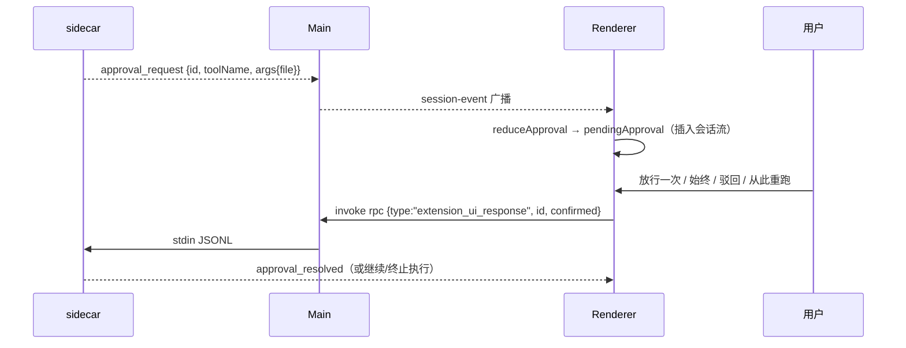

# 06 · 协议与数据模型

本页是「渲染层 ↔ 主进程 ↔ sidecar」之间全部契约的清单，以及本仓自己维护的数据落点。
协议名与事件字段以当前代码实际使用为准（sidecar 由 `../C-code` 基座提供，协议版本 v8）。

## 1. RPC 命令（Renderer → Main → sidecar）

主进程 `ipcMain.handle("rpc")` 直通；命令体即 JSONL 一行。当前渲染层使用的命令：

| 命令 | payload | 使用方 | 说明 |
| --- | --- | --- | --- |
| `get_state` | `{}` | `app.useSidecarSync` | 启动探活；成功即 connection=ready |
| `get_entries` | `{}` | 同上 | 调用了但**返回值当前未使用**（历史未回填） |
| `get_available_models` | `{}` | `ModelPicker` | 返回 `{data:{models: AvailableModel[]}}` 或 `{models}`；`AvailableModel={provider,modelId,label?,supportedLevels?}` |
| `set_model` | `{provider, modelId}` | `ModelPicker.handleSelect` | 切换 sidecar 当前模型 |
| `prompt` | `{message, thinkingLevel, model?}` | Composer / 分工降级 | 发起一轮；`thinkingLevel` ∈ thinking 7 档；`model` 为 `provider/model` 或空 |
| `extension_ui_response` | `{id, confirmed}` | 审批卡 / 蓝图抽屉 | 审批回执：`confirmed:true` 放行，`false` 驳回（见 §3） |
| `abort` | `{}` | 蓝图「从此重跑」 | 中止当前执行 |
| `teamwork.start` | `{runId, goal, team: TeamRoster}` | 分工配置 Sheet | 下发分工 roster；不支持时降级为 `prompt` |

> 兼容通道（`sessions/turns/approval/models/blueprint/settings/log`）会把 payload 附加 `__channel` 字段后原样转发，属于旧接口，当前主链路不依赖。

## 2. 事件（sidecar → Main → Renderer）

Main 把非响应记录统一 `webContents.send("session-event", rec)`；渲染层同时订阅 `session-event` 与 `turns`。
事件按 `type` 分发，全部在 `store.applyEvent` 内并轨归约：

| 事件 type | 关键字段 | 归约结果 |
| --- | --- | --- |
| `turn_start` | — | 新增蓝图 `plan` 节点（running）；渲染层也会本地补发一次 |
| `message_update` | `assistantMessageEvent:{type:"text_delta", delta}` | 助手消息流式追加（末尾 streaming 消息，否则新建） |
| `message_end` | `message:{model, usage:{inputTokens,outputTokens,cacheRead}}` | 消息定稿（done + tokens）；蓝图本轮节点与轨迹回填 cost/model |
| `tool_execution_start` | `toolName, toolCallId, args` | 新增蓝图节点（running，kind 由工具名推断）；记录开始时间 |
| `tool_execution_end` | `toolName, toolCallId, args, result, isError` | 节点 done/failed；生成 `TraceEvent`（summary/args/result/startedAt/durationMs） |
| `turn_end` / `agent_settled` | — | 本轮 running 节点全部置 done |
| `approval_request` / `tool_approval_request` | `id/toolCallId, toolName, args{file|path}` | 生成待审批卡 `pendingApproval` |
| `approval_resolved` / `approval_cancelled` | — | 清空审批卡 |
| `teamwork.started` | `runId, goal, team` | 初始化分工面板（leader working，worker/reviewer pending） |
| `member.started` | `runId, taskId?, role?, description?, provider?, model?, thinkingLevel?, taskTitle?` | worker → working（定位：roleId → taskId → kind）；roster 外补行 |
| `member.completed` | `runId, taskId?, role?, summary?, usage?` | worker → completed |
| `member.failed` | 同上（无 usage） | worker → failed |
| `review.started` | `runId, provider?, model?` | reviewer → reviewing，phase=reviewing |
| `review.completed` | `runId, verdict:"pass"\|"needs_fix", summary?` | reviewer → completed + 结论 |
| `teamwork.completed` | `runId, phase` | phase 收敛；store 清空 `teamworkConfig`（一次一配） |
| `sidecar_exit` | `code`（Main 构造） | connection=error，提示 `sidecar exited <code>` |

## 3. 审批流



当前四种决策的上行映射：

| 决策 | `confirmed` | 备注 |
| --- | --- | --- |
| 放行一次 / 始终 | `true` | 两者上行相同，粒度控制依赖基座 |
| 驳回 | `false` | |
| 从此重跑 | `false` | 蓝图抽屉的重跑走 `abort + prompt("rerun from …")`，与本卡不同 |

## 4. 模型接入契约（`~/.c-code/agent/models.json`）

桌面端由 Main 的 `models-json` 通道直接读写（0600 权限），sidecar 读同一文件发请求；Web 模式降级到 localStorage（`ccode.providers.v1`）。

```jsonc
{
  "providers": {
    "<providerId>": {
      "baseUrl": "https://api.deepseek.com",   // 去尾部斜杠
      "api": "openai-completions",              // openai-completions | openai-responses | anthropic-messages
      "apiKey": "sk-…",                         // 本地服务可空
      "models": [{ "id": "deepseek-chat" }]     // 统一为对象数组
    }
  }
}
```

写路径：`ProviderForm 保存 → saveProviderConfig → preload invoke("models-json") → Main mergeProviders + saveModelsJson`。
探测路径：`probeProvider → Main fetch GET /models`（Anthropic 用 `x-api-key` + `anthropic-version: 2023-06-01`）。

## 5. localStorage 键

| 键 | 内容 | 上限/说明 |
| --- | --- | --- |
| `ccode.sessions.v1` | 会话索引 `[{id,title,updatedAt,workspace?}]` | 100 条，按 updatedAt 倒序 |
| `ccode.session.<id>.v1` | 会话正文 `{messages, trace}` | messages 200 / trace 500；`s0` 不落盘 |
| `ccode.settings.v1` | `{workspace, byok}` | 明文（本地应用） |
| `ccode.workspaces.v1` | 项目列表 `[{id,path,addedAt}]` | 50 条 |
| `ccode.profile.v1` | `{id,name,color}` | 颜色 `#RRGGBB` 校验 |
| `ccode.providers.v1` | 提供商配置（仅 Web 模式） | 桌面模式写 models.json |
| `ccode.selectedModel.v1` | 当前模型 `provider/model` | 启动恢复 |
| `ccode.effort.v1` | 思考档字符串 | 启动恢复 + 切模型钳制 |
| `ccode.localStt.model.v1` | 本地转写模型档 `whisper-tiny/base/small` | 默认 `whisper-tiny`（`lib/local-stt.ts`） |

## 6. 文件系统落点

| 路径 | 写入者 | 说明 |
| --- | --- | --- |
| `~/.c-code/agent/models.json` | Main（`models-json`） | 0600；sidecar 消费 |
| `~/.c-code/app-server-desktop.pid` | Main（`pidfile.writePid`） | 桌面端 profile 固定 `desktop` |
| `~/.c-code/logs/desktop/app.log[.1,.2]` | Main（stderr 转发） | 1MB 轮转 3 份 |
| `resources/bin/`（仓库内） | `scripts/sync-sidecar.mjs` | vendored sidecar（gitignore） |

`C_CODE_HOME` 环境变量可覆盖 `~/.c-code`（Main 与 tests 同一套默认值）。

## 7. 导出格式

| 产物 | 格式 |
| --- | --- |
| `trace.jsonl` | 每行一个 `TraceEvent` JSON（含 summary/args/result/计时字段） |
| `blueprint.json` | `{nodes: BlueprintNode[], edges: {from,to}[]}` |
| `snapshot.json` | `{version:1, exportedAt, trace, blueprint:{nodes,edges}, selectedModel, workspace}` |
| `meta.json`（ZIP 内） | `{sessionId, sessionTitle, model, mode, effort, exportedAt}` |
| `session.jsonl`（ZIP 内） | 每行一个 `ChatMessage` |
| `c-code-session-<id>.zip` | store-only ZIP（`meta.json + session.jsonl + trace.jsonl + blueprint.json`） |

## 8. 版本与兼容

- sidecar 协议版本：`PROTOCOL_VERSION = 8`（`apps/desktop/src/main/sidecar.ts`）；与基座 pi-protocol v8 对应。
- 思考档与基座 `EXTENDED_THINKING_LEVELS` 全量对齐（7 档），兼容老三档 low/medium/high。
- teamwork 事件名与基座 `packages/coding-agent/src/core/teamwork/types.ts` 对齐，worker 标签语义（`formatWorkerLabel ↔ formatWorkerLabel`）保持一致。
- 本仓所有持久化键都带 `.v1` 后缀；升级 schema 时新增版本号键，不原地改语义。