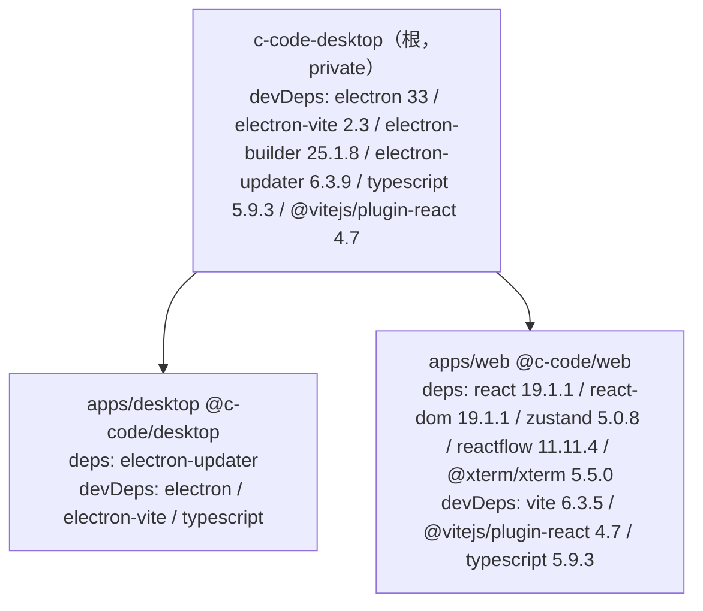
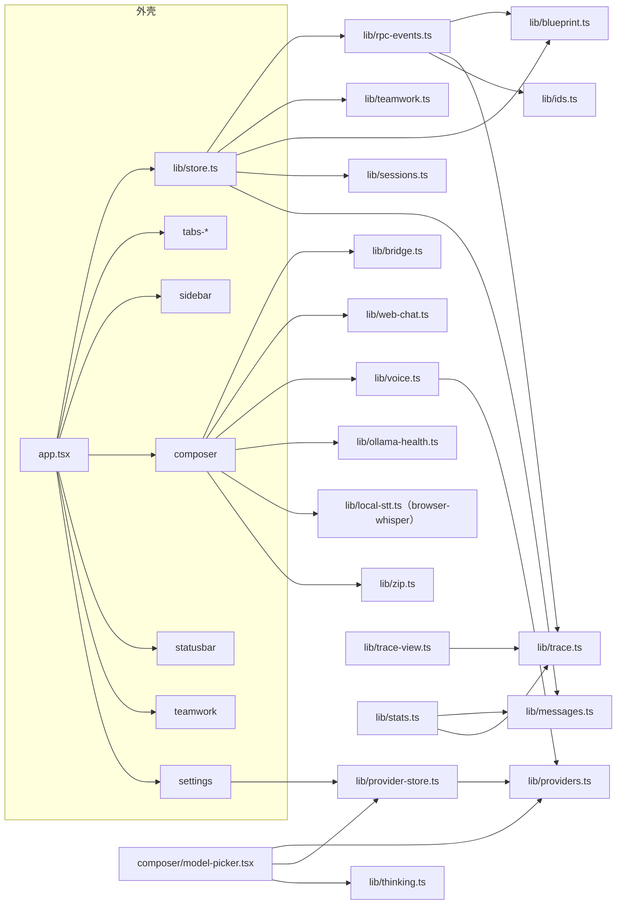
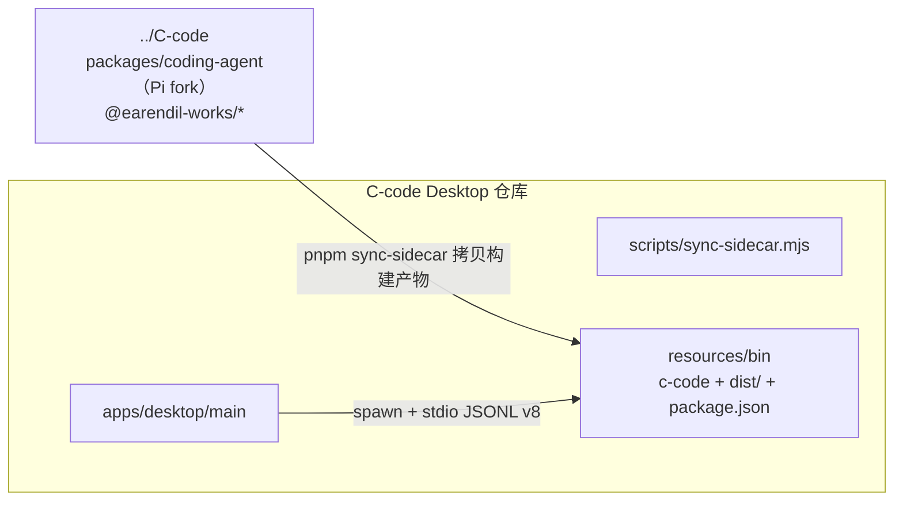

# 07 · 依赖关系

## 1. 工作区与包结构



- pnpm workspace 仅包含 `apps/*`（`pnpm-workspace.yaml`）；**刻意不设 `packages/*`**。
- 两个子包都不发 npm，`private: true`。
- Node 要求：`>=22.19.0`（根与 sidecar 一致）。

## 2. 三方依赖清单与使用位置

| 依赖 | 版本 | 用途 | 实际使用位置 |
| --- | --- | --- | --- |
| `electron` | 33.0.0（dev） | 桌面宿主 | 主进程全部；构建时由 electron-vite 打包 |
| `electron-vite` | 2.3.0（dev） | main/preload/renderer 三段构建与 dev server | `electron.vite.config.ts` |
| `electron-builder` | 25.1.8（dev） | dmg/zip/nsis 打包 | `electron-builder.yml`、根 `build*` 脚本 |
| `electron-updater` | 6.3.9 | 更新机制（声明依赖） | **当前源码未 import**（无 updater 模块，见 09） |
| `typescript` | 5.9.3（dev） | 类型检查/编译 | `pnpm check`、desktop 构建脚本（缺 tsconfig，见 08/09） |
| `@vitejs/plugin-react` | 4.7.0（dev） | React 快速刷新与 JSX 转换 | 根 electron.vite renderer 段 + `apps/web/vite.config.ts` |
| `react` / `react-dom` | 19.1.1 | UI 框架 | 全部 `.tsx` |
| `zustand` | 5.0.8 | 全局状态（单 store） | `lib/store.ts` |
| `reactflow` | 11.11.4 | 蓝图 DAG 渲染 | `tabs-blueprint/index.tsx` |
| `browser-whisper` | ^1.1.0 | 纯本机语音转写（浏览器内跑 whisper，无 key、无上传） | `lib/local-stt.ts` 动态 import（失败回落 API 转写） |
| `@xterm/xterm` | 5.5.0 | 终端组件（声明依赖） | **当前源码未 import**（V1 未接终端视图，见 09） |
| `vite` | 6.3.5（dev） | 独立 `dev:web`/`apps/web build` | `apps/web/vite.config.ts` |

Node 内置能力（无三方包）：`node:test`（测试）、`node:child_process`、`node:fs`、`node:path`、`node:os`、`node:url`。

## 3. 模块内部依赖（渲染层）



规则（`EXTENSIBILITY.md`）：

- `lib/` 内部不引入 React，可被 Node 测试直接 import；组件层只做渲染与事件绑定。
- 同一份小工具需要跨端复用时**复制而非抽包**（例如 `probeRequest` 在渲染层，`probe` 的 fetch 执行在主进程，二者没有共享代码）。
- 唯一跨进程共享的契约是字符串名（通道名、事件名、命令名），没有类型包或生成代码。

## 4. 与 C-code 基座（sidecar）的依赖



依赖边界：

| 依赖项 | 说明 |
| --- | --- |
| 构建产物 | `dist/bundle/cli.js`（入口）、`dist/`（modes/core 等资产）、`package.json`（包根标记）、`node_modules` symlink（dev 解析裸模块） |
| 协议 | `--mode rpc --no-session [--cwd]`、JSONL 帧、v8 事件名（见 06） |
| 运行时资产路径 | 包形态决定了基座 `getPackageDir()` 能正确解析 `dist/modes/interactive/theme` 等路径 |
| 版本策略 | 二进制由同步脚本「pin」在 `resources/bin`；仓库不锁定基座 commit（同步时取 `../C-code` 当前构建产物） |
| 不依赖 | 不 import 任何 `@earendil-works/*` npm 包；不修改基座源码 |

## 5. 主进程内部依赖

```
index.ts → sidecar.ts（pickBin/buildEnv/env 常量）
        → rpc-bridge.ts（buildRpcArgs/splitFrames/parseRecord/encodeCommand + models.json 读写）
        → pidfile.ts（writePid）
        → log.ts（appendLog）
preload/index.ts → electron（contextBridge/ipcRenderer）
```

单向、无循环；四个工具文件均为纯函数，`index.ts` 是唯一编排点。

## 6. 依赖健康度自查

| 项 | 现状 |
| --- | --- |
| 未使用依赖 | `@xterm/xterm`（渲染层）、`electron-updater`（desktop）已在 package.json 声明但源码未引用 |
| 新增依赖 | `browser-whisper`（^1.1.0）用于本地语音转写；由 `lib/local-stt.ts` 动态 import，属于可选路径（失败自动回落 API 转写） |
| 缺失配置 | 仓库无 `tsconfig.json`，`pnpm check` / desktop 构建里的 `tsc -p tsconfig.json` 目前无法通过（`pnpm dev` 不受影响，esbuild 直接转译） |
| 打包产物目录 | electron-vite 输出在根 `out/`；`electron-builder.yml` 的 `files` 列的是 `apps/*/dist`，打包前需核对（详见 09） |
| 测试框架 | 无第三方测试库，使用 Node 内置 runner；`package.json` 未提供 test 脚本（命令见 08） |